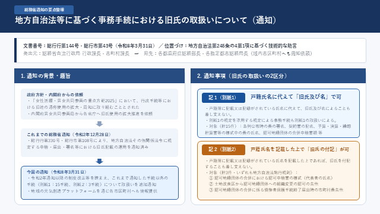

# vsto-llm-pptcom

## 概要

PowerPointで開いているプレゼンテーションを、LLMが作ったり直したりするアドインです。
主要依存ライブラリのバージョンは以下の通りです。npmへの依存はありません。
- PDF.js 6.5.438
- anydoc 0.2.4

## 動作環境

- Windows 11
- PowerPoint 2019以降
- Microsoft Edge WebView2ランタイム
- OpenAI互換のAPIを持つ接続先（チャット用モデル。任意で画像生成用モデル。）

## 主な機能

- 「こんなパワポ作って」などの自然言語でパワーポイントを作成できます。
- Word・Excel・PowerPoint・PDF・テキストのファイルを添付し、「この資料を5枚にまとめて」のような依頼も可能です。
- 画面や図形を作業ウィンドウに貼り付け、「こんな感じのグラフ/スライドを作って」と指示できます。
- PowerPointの図形や文字、スライドの選択もAIに伝わるので、図形を選んで「これを赤くして」のように頼めます。
- LLMはVBAに近い短いスクリプト（pptcomスクリプト）を書きます。アドインがそれを検査してからPowerPointで実行します。
- 多言語対応です。


### 作例: 同じ依頼でモデルを替えたもの

総務省の通知「地方自治法等に基づく事務手続における旧氏の取扱いについて」の[本文](https://www.soumu.go.jp/main_content/001083961.pdf)・[別紙1](https://www.soumu.go.jp/main_content/001083971.pdf)・[別紙2](https://www.soumu.go.jp/main_content/001083966.pdf)のPDFを添付し、内容をまとめる依頼をしたものです（アドイン0.0.8、画像生成はZ-Image）。スライドの内容的な正誤は確かめていません。

<table>
<tr>
<td align="center"><br>Claude Opus 5.5（<a href="docs/examples/claude-opus-5.5.pdf">PDF</a>、<a href="docs/examples/claude-opus-5.5.pptx">pptx</a>）</td>
<td align="center"><br>Claude Sonnet 5.5（<a href="docs/examples/claude-sonnet-5.5.pdf">PDF</a>、<a href="docs/examples/claude-sonnet-5.5.pptx">pptx</a>）</td>
<td align="center"><br>Claude Haiku 5.5（<a href="docs/examples/claude-haiku-5.5.pdf">PDF</a>、<a href="docs/examples/claude-haiku-5.5.pptx">pptx</a>）</td>
</tr>
<tr>
<td align="center"><br>GPT-6.1 Sol（<a href="docs/examples/gpt-6.1-sol.pdf">PDF</a>、<a href="docs/examples/gpt-6.1-sol.pptx">pptx</a>）</td>
<td align="center"><br>Gemini 4 Argon（<a href="docs/examples/gemini-4-argon.pdf">PDF</a>、<a href="docs/examples/gemini-4-argon.pptx">pptx</a>）</td>
<td align="center"><br>Muse Wonder（<a href="docs/examples/muse-wonder.pdf">PDF</a>、<a href="docs/examples/muse-wonder.pptx">pptx</a>）</td>
</tr>
<tr>
<td align="center"><br>DeepSeek-V4.1-Flash-1017（<a href="docs/examples/deepseek-v4.1-flash-1017.pdf">PDF</a>、<a href="docs/examples/deepseek-v4.1-flash-1017.pptx">pptx</a>）</td>
<td align="center"><br>Qwen3.8-Flash-Next（<a href="docs/examples/qwen3.8-flash-next.pdf">PDF</a>、<a href="docs/examples/qwen3.8-flash-next.pptx">pptx</a>）</td>
<td align="center"><br>Gemma 4 31B（<a href="docs/examples/gemma-4-31b.pdf">PDF</a>、<a href="docs/examples/gemma-4-31b.pptx">pptx</a>）</td>
</tr>
</table>

下の段の3つはオンプレミスのvLLMで動かしたもので、いずれも思考ありです。DeepSeek-V4.1-Flash-1017はオリジナルウェイト（[deepseek-ai/DeepSeek-V4.1-Flash-1017](https://huggingface.co/deepseek-ai/DeepSeek-V4.1-Flash-1017)）、Qwen3.8-Flash-NextはNVFP4に量子化したもの（[Inferact/Qwen3.8-Flash-Next-NVFP4](https://huggingface.co/Inferact/Qwen3.8-Flash-Next-NVFP4)）、Gemma 4 31BはQAT版（[google/gemma-4-31B-it-qat-w4a16-ct](https://huggingface.co/google/gemma-4-31B-it-qat-w4a16-ct)）です。


## 必要な設定

設定は、インストール（管理者権限不要）後に、作業ウィンドウの上の歯車アイコンから行います。  
設定項目は以下のとおりです。

- 接続先URL（必須）
- LLMモデル名（必須）
- コンテキスト上限: このトークン数を超えると、経過を要約します。既定値は、そのモデルの最大入力の75%です（自動検出できなければ100,000）。
- 画像生成モデル名（使用する場合）
- 画像生成プロンプト: AIが画像を頼むときの指示の書き方と大きさ（Z-Image用とMOSS-Image用）
- APIキー（必要な場合。設定すると、接続先URLにはhttpsしか設定できません。）
- スライドを開いたらAIアシスタントを表示する: アドインを自動で表示するかどうか（既定でオン）
- 途中経過を保存する: 記録を`%LOCALAPPDATA%\KashiharaCity\pptcom\`に残すかどうか（既定でオフ）
- 他のプログラムからの操作を許可する: 他のプログラムからの操作を受け付けるか（既定でオフ）

## インストールされるものと書き込む場所

ここから以下は、運用管理者向けの説明です。  

インストーラは、アドインとしての動作のために、所定の場所（レジストリと`%LOCALAPPDATA%`）に情報を書き込みます。  
また、アドイン自体も、ログオンしているユーザーごとに、所定の場所（Windows資格情報、レジストリ、`%LOCALAPPDATA%`）に情報を保存します。

インストーラが保存したものはアンインストールで消えます。アドイン自体が保存したものは残るので、不要なら手動削除してください。

### Windows資格情報マネージャー

```
資格情報マネージャー\Windows資格情報\汎用資格情報\
└─ KashiharaCity/pptcom:api_key         接続先のAPIキー（アドインが保存）
```

### レジストリ

```
HKEY_CURRENT_USER\Software\
├─ KashiharaCity\pptcom\
│  ├─ endpoint                         ＊接続先（アドインが保存）
│  ├─ chat_model, context_limit        ＊LLMモデルとコンテキスト上限（アドインが保存）
│  ├─ image_model, image_prompt        ＊画像生成モデルと画像生成プロンプト（アドインが保存）
│  ├─ open_pane, save_progress, external_control   ＊3つのスイッチ（アドインが保存）
│  ├─ AppVersion                       入っているバージョン（インストーラが保存）
│  ├─ LatestVersion                    ＊配布するバージョン（管理者がグループポリシーで設定）
│  └─ Installer\                        インストーラの参照情報（インストーラが保存）
│     └─ Files, WebView2LoaderX86, WebView2LoaderX64
└─ Microsoft\
   ├─ Office\PowerPoint\Addins\pptcom\  起動時にアドインを読み込む設定（インストーラが保存）
   │  └─ Description, FriendlyName, LoadBehavior (3), Manifest
   ├─ VSTO\Security\Inclusion\9E192468-0F34-4BCE-9263-052B3358849B\
   │  └─ Url, PublicKey                 アドインの信頼済み一覧（インストーラが保存）
   ├─ VSTO\SolutionMetadata\            読み込んだ.vstoごとの情報（アドインが保存）
   └─ Office\16.0\PowerPoint\AddInLoadTimes\
      └─ pptcom                         読み込みにかかった時間（Office本体が保存）
```


＊は、組織で配布する際に、グループポリシーで設定する意味がある設定です。以下はその設定例です。

| 値の名前 | 型 | 例 | 書き方 |
|---|---|---|---|
| `endpoint` | REG_SZ | `https://litellm.example.com` | スキームとホスト名（とポート）まで。パスは使わない（`/v1/chat/completions`などはアドインが付ける） |
| `chat_model` | REG_SZ | `Qwen3-VL-32B-Instruct` | 接続先のモデル一覧（`/v1/models`）に出る名前。スライドの描画を画像で渡すので、画像を読めるモデル |
| `context_limit` | REG_DWORD | `100000` | トークン数（8000〜10000000）。無いときや範囲外なら、モデルの最大入力の75%（分からなければ100,000）になる |
| `image_model` | REG_SZ | `z-image-turbo` | 接続先のモデル一覧に出る、画像生成（`/v1/images/generations`）のモデル。空なら画像を作らない |
| `image_prompt` | REG_SZ | `zimage` | 画像生成プロンプト。無いときや知らない値は`zimage`になる |
| `open_pane` | REG_DWORD | `1` | 1でスライドを開いたらAIアシスタントを表示する。無ければ1 |
| `save_progress` | REG_DWORD | `0` | 1で途中経過を保存する。無ければ0 |
| `external_control` | REG_DWORD | `0` | 1で他のプログラムからの操作を許可する。無ければ0 |
| `LatestVersion` | REG_SZ | `0.0.7` | 配布するバージョン。`AppVersion`と同じ書き方 |


### `%LOCALAPPDATA%\KashiharaCity\pptcom\`

```
%LOCALAPPDATA%\KashiharaCity\pptcom\
├─ app\
│  ├─ pptcom.vsto, pptcom.dll.manifest   署名付きの設定ファイル（インストーラが配置）
│  ├─ pptcom.dll                 アドイン本体（インストーラが配置）
│  ├─ Microsoft.Office.Tools.Common.v4.0.Utilities.dll   アドインの部品（インストーラが配置）
│  ├─ runtimes\win-x86\native\WebView2Loader.dll
│  ├─ runtimes\win-x64\native\WebView2Loader.dll         WebView2ライブラリ（インストーラが配置）
│  └─ THIRD-PARTY-NOTICES.md     同梱している第三者のライセンス（インストーラが配置）
├─ temp\
│  ├─ WebView2\                  作業ウィンドウの閲覧データ（アドインが保存）
│  └─ work\                      スライドの描画、生成した画像、資料の画像など（アドインが保存）
├─ session.log                ＊ 依頼、モデルの推論と応答、ツールの実行結果（アドインが保存）
├─ com_usage.jsonl            ＊ 実行したPowerPointの操作（アドインが保存）
└─ generated-pptx\addin_<日時>\ ＊ デッキのコピーなど（アドインが保存）
```

＊ は「途中経過を保存する」がオンのときだけ保存します。

## pptcom.dllの構造

ここから以下は、開発者向けの説明です。  
vsto-llm-pptcomの主な機能を担うpptcom.dllは、以下のような構造となっています。

```
PowerPoint
└─ pptcom.dll
   ├─ C#のコード
   │   ├─ ThisAddIn             ウィンドウごとの作業ウィンドウと会話（添付資料も会話に属す）、エージェントのループ
   │   ├─ AddinSettings         設定（レジストリ）とAPIキー（資格情報マネージャー）
   │   ├─ AddinAutomation       他のプログラムからの操作（「他のプログラムからの操作を許可する」がオンのときだけ）
   │   ├─ Agent                 LLMとの通信（OpenAI互換のAPI、ストリーミング）、会話を短くする処理、依頼ごとに渡すツールと指示の組み立て
   │   ├─ ComProxy              pptcom（資料の画像もd1_img3などの変数として貼れる）
   │   ├─ Documents             添付資料の保持、docread、画像の変換
   │   ├─ AiTaskPaneControl     作業ウィンドウ（WebView2）の土台。DLL内のファイルを返す
   │   ├─ PaneRibbon            ホームタブの「AIアシスタント」ボタン
   │   └─ PaneText / Texts      作業ウィンドウに送るメッセージ（コードと値）、アドインが自分で描く文言
   ├─ 結合したライブラリ         Newtonsoft.Json、WebView2 SDK（Core、WinForms）
   ├─ 埋め込みのファイル（Agent/）
   │   ├─ system-prompt.txt / tools.json   モデルへの指示とツールの定義（AgentFileが読む）
   │   ├─ image-prompts/*.json             画像生成プロンプト（モデル別）
   │   └─ compaction-prompt.txt            会話を短くする前に、モデルに経過のメモを書かせる指示
   └─ 埋め込みのファイル（UI/web/）
       ├─ 画面          index.html / taskpane.js / taskpane.css
       ├─ 文言          i18n.js、locales/<言語>.json（メッセージのコードごとの文言）
       ├─ docs.js       ドロップと添付の受付、PDFのページの描画
       ├─ docworker.js  Word・Excel・PowerPoint → 文字（anydoc）
       ├─ pdfdoc.js     PDF → 文字と画像（PDF.js）
       └─ vendor/       anydoc（WebAssembly）、PDF.js
```

## ビルド

ビルドには、次のものが必要です。

- Visual Studio Build Tools 2026の18.9以降（「Office/SharePoint ビルド ツール」に、オプションの「Visual Studio Tools for Office (VSTO) ビルド ツール」と「.NET Framework 4.8 開発ツール」を足したもの）。
- Rust 1.99.1とwasm32-unknown-unknownターゲット（`rustup toolchain install 1.99.1 --profile minimal --target wasm32-unknown-unknown`）
- .NET SDK 6以降（MSIを組むWiX v5を`dotnet build`で動かすため）
- GACにあるOfficeのPIA（Officeを入れたPCにはあります。OfficeのないPCでは、VSTOのビルド タスクがアドインのリボンの型を読めずに止まるので、上の「Office/SharePoint ビルド ツール」が置くPIAを`gacutil /i`で入れます。CIはそうしています）

```
powershell -ExecutionPolicy Bypass -File scripts\build\new-signing.ps1   # 初めてビルドする PC で 1 回だけ
powershell -ExecutionPolicy Bypass -File scripts\build\build.ps1
```

VSTOのビルドは、組んだアドインをこのユーザーのPowerPointに登録します（次にPowerPointを開くと、そのビルドが読み込まれます）。`-p:RegisterAddin=false`を付けると登録を変えません。`build.ps1`はこれを付けてReleaseを組むので、開発中のDebugの登録はそのままです。`build.ps1 -NoRestore`は、NuGetから取りに行かず、手元にあるパッケージで組みます。

VSTOのビルドはClickOnceのマニフェストに署名するので、開発機ごとにテスト用の証明書が要ります。`new-signing.ps1`が自己署名の証明書と署名の設定を`temp\signing\`に作ります（Gitの管理外。消したときは作り直せば済みます）。ビルドの生成物は、どのプロジェクトも`temp\build\<プロジェクト名>\`の`bin\<構成>\`と`obj\`にでき、MSIは`release\`にできます。アドインには、ビルドしたときのコミットをgitから埋め込みます（`pptcom/CommitInfo.targets`。未コミットの変更があれば`+`が付き、gitが無ければ`unknown`）。

作業ウィンドウで使うPDF.jsとanydocは、公式の配布元から取ったものを`deps/`に置き、版とハッシュを`deps/web-sources.lock.json`で固定しています。npmは使いません。

- PDF.js: MozillaがGitHubのリリースで配布している`pdfjs-<版>-dist.zip`から、使うファイルだけを取り出します。
- anydoc: タグのコミットのソース（`deps/anydoc.tar.gz`）から、anydoc自身のリリースと同じ手順（cargo → wasm-bindgen → wasm-opt）でWebAssemblyに組みます。

版を上げるときは`scripts/deps/fetch-web.py`の版を書き換えて実行します。公開から7日たっていない版は取りません。

## テスト

### 静的解析

C#のコードは、ビルドのたびに静的解析（Microsoft.CodeAnalysis.NetAnalyzers、Microsoft.CodeAnalysis.CSharp.CodeStyle、Meziantou.Analyzer）にかけ、警告はエラーとして扱います。言語の版と解析器の版は`Directory.Build.props`、止めている規則等は、`.editorconfig`にあります。古い形式のcsprojには.NET SDKの規則の一覧が渡らないので、NetAnalyzersの一覧は`scripts/deps/netanalyzers-config.py`がパッケージから作って`deps/analyzers/`に置きます。

### 自動テスト

どれもPowerPointとLLMなしで動き、GitHub Actionsの`ci.yml`のcheckジョブでも流します（手で流したときと、タグをpushしたとき）。C#の2つはMSBuildで組んでから実行します。ほかにPython 3とNode.jsが要ります。

| 実行するもの | 調べること |
|---|---|
| `temp\build\ComScriptTests\bin\Debug\ComScriptTests.exe` | pptcomスクリプトの解析と実行（式の値はVBScriptとVBAの値と照らす）。断る文とメンバー、依頼のプレゼンテーションの固定、グラフのデータで使えるもの、書いた文字に入れる言語とその対象。モデルへの報告（エラーの案内、引数の丸め、図形一覧の中身とアニメーション、背景に対して見えにくい文字、角丸の角からはみ出す四角い図形） |
| `temp\build\ChatStreamTests\bin\Debug\ChatStreamTests.exe` | LLMとの通信（応答の読み取り、失敗の見分け、中止と待ち時間、APIキーの扱い）。依頼のターン（作業ウィンドウとPowerPointは偽物で、ツールの実行、pptcomの呼び出しの案内の表示、ターンの上限、再試行と中止、文脈の上限での会話の短縮）。モデルに渡すもの（ツールとシステムプロンプト、会話の短縮、表示言語と日付、画像の色）。添付の受け付け |
| `node scripts/test/docs-queue.cjs` | 作業ウィンドウの添付（`docs.js`）。どこで失敗しても後のファイルが続くこと、画像と貼り付けの扱い |
| `node scripts/test/taskpane.cjs` | 作業ウィンドウの送信と表示（`taskpane.js`）。依頼の送り方と終わり方、「続ける」、設定欄、APIキーの入力と削除 |
| `python -X utf8 scripts/test/js-syntax.py` | 作業ウィンドウのJavaScriptが構文として読めること |
| `python -X utf8 scripts/test/i18n.py` | 文言のコードと言語ファイルがそろい、コードに日本語の文が無いこと |
| `python -X utf8 scripts/test/no-secrets.py` | Gitが追跡するファイルに、私有IP、社内のホスト名、APIキー、開発機のパス、鍵や証明書が無いこと |
| `python -X utf8 scripts/deps/netanalyzers-config.py --check` | NetAnalyzersの規則の一覧が、固定した版のパッケージと合うこと |
| `python -X utf8 scripts/test/build-warnings.py <ログ>...` | ビルドの警告が、既知のCS8032だけであること |

- ComScriptTestsの式の値は`expected.tsv`（VBScriptで求めた値）と照らします。式を足したら`make_expected.vbs`で作り直します。
- no-secrets.pyは、`--history`で全コミットを、`--self-test`で自分自身を確かめます。パターンで見分けられない語は`notes/secrets-denylist.txt`（Gitの管理外、1行に1語）に書くと照合します。
- build-warnings.pyのログは、MSBuildの`-flp:logfile=<ログ>;warningsonly`で作ります。CS8032は、解析器の1つが読み込めないという警告です。

### 実機でのテスト

本物のPowerPointやLLMを使うので、CIでは流しません。

- `scripts/test/ComScriptRunner`: PowerPointを外から動かし、アドインと同じ解析・実行・検査でpptcomスクリプトを流す（CIでは、ビルドの警告を確かめるために組むだけ）
- `scripts/test/drive_addin.ps1`: 本物のアドインを外から操作する（依頼、新しい会話、中止、添付、続ける）。作業ウィンドウの設定で「他のプログラムからの操作を許可する」をオンにしてから使う
- 記録の集計と実験: `usage_report.py`（COMの呼び出しの集計）、`used_members.py`（モデルが使ったCOMのメンバー）、`extract_corpus.py`（過去のスクリプトを集め、パーサの変更の前後で比べる）

## リリースと検証

タグ`v*`をpushすると、GitHub Actions（`.github/workflows/ci.yml`）が検査（checkジョブ）のあと、そのタグのソースからMSIを組み、CycloneDX 1.6のSBOMを作って、両方に証明（attestation）を付けてからGitHub Releaseに載せます（releaseジョブ）。手で流すとき`msi`を選ぶと（`gh workflow run ci.yml -f msi=true`）、そのときのコミットで同じことをして、Releaseには載せません。受け取ったMSIは、次のコマンドで確かめられます。

```
gh attestation verify vsto-llm-pptcom-<版>.msi --repo kashihara-city/vsto-llm-pptcom
gh attestation verify vsto-llm-pptcom-<版>.msi --repo kashihara-city/vsto-llm-pptcom --predicate-type https://cyclonedx.org/bom
```

1つ目は「このリポジトリのワークフローが組んだMSIであること」（来歴）、2つ目は「ReleaseにあるSBOM（`vsto-llm-pptcom-<版>.cdx.json`）がこのMSIのものであること」を確かめます。SBOMは`scripts/build/sbom.py`が固定済みの記録だけから作り、`scripts/test/sbom.py`が公式のスキーマ（`deps/cyclonedx/`、ハッシュで固定）と記録に照らして確かめます。

## リポジトリの構成

```
pptcom/                アドイン本体（C#、VSTO）
├─ Agent/              LLMとの通信、モデルへの指示とツールの定義
├─ ComProxy/           pptcomスクリプトの解析と実行、使ってよいメンバーの検査
├─ Documents/          添付した資料
├─ Polyfills/          C#のrequiredに要る属性
└─ UI/                 作業ウィンドウ（web/ が画面、web/locales/ が文言）
deps/                  固定した外部のもの（PDF.js、anydoc、CycloneDXのスキーマ、NetAnalyzersの規則）
scripts/build/         MSI、SBOM、テスト証明書を作る
scripts/deps/          deps/ を更新する
scripts/test/          テストと実験用の道具
.github/               CI（手で流す検査と、タグからのリリース）
docs/                  READMEの画像と作例（examples/）
licenses/              同梱している第三者のライセンス
```

