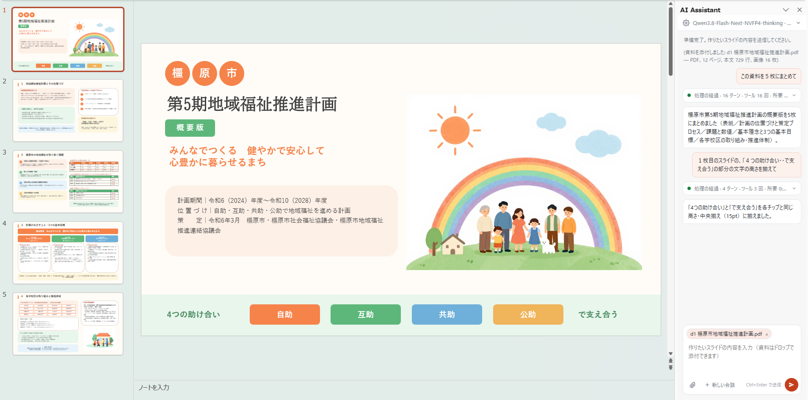

# vsto-llm-pptcom

## 概要

PowerPoint で開いているプレゼンテーションを、LLM が作ったり直したりするアドインです。
主要依存ライブラリのバージョンは以下の通りです。npm への依存はありません。
- PDF.js 6.4.299
- anydoc 0.2.4

## 動作環境

- Windows 11
- PowerPoint 2019 以降
- Microsoft Edge WebView2 ランタイム
- OpenAI 互換の API を持つ接続先（チャット用モデル。任意で画像生成用モデル。）

## 主な機能

- 「こんなパワポ作って」などの自然言語でパワーポイントを作成できます。
- Word・Excel・PowerPoint・PDF・テキストのファイルを添付し、「この資料を5枚にまとめて」のような依頼も可能です。
- 資料の図や写真を、そのままスライドに貼ることもできます。
- 画像も添付できます。画面の切り取りや、PowerPoint でコピーしたスライド・図形を作業ウィンドウに貼り付け（Ctrl+V）、「こんな感じのグラフ」「ここを直して」と画像で伝えられます。コピーしたものに文字があるとき（Excel のセルなど）は、文字として貼られます。
- 作業ウィンドウの入力欄の上に、PowerPoint で選んでいる図形や文字、スライド（何も選んでいなければ表示中のスライド）が出ます。依頼を送ると、その選択も AI に伝わるので、図形を選んで「これを赤くして」のように頼めます。
- LLM は VBA に近い短いスクリプト（pptcom スクリプト）を書きます。アドインがそれを検査してから PowerPoint で実行します。
- プレゼンテーションのウィンドウごとに作業ウィンドウがあり、会話もウィンドウごとに続きます。作業ウィンドウはホームタブの「AIアシスタント」ボタンで表示と非表示を切り替えます（閉じたときもここから開きます）。依頼は一度に 1 つで、実行中はほかのウィンドウの作業ウィンドウは待ちます。
- 1 つの依頼は 20 ターン（モデルが答えてツールを使う 1 往復が 1 ターン）までで止まります。そこで止まったときは作業ウィンドウに「続ける」が出て、押すと止まったところからもう 20 ターン続けます。それまでの経過は、短くせずにそのままモデルに渡ります。
- 1 ターンの入力が設定の「コンテキスト上限」を超えると、そのターンのあとで、モデルが自分の経過を要約します（何を作っていて、次に何をするか）。そのうえで古い推論・スクリプト・資料の本文・図形の一覧を一度にまとめて省き、要約を最後に置いて続けます。直近の 2 ターン、ツールの結果、各スライドの最新の描画はそのまま残ります。要約しても作業の記録が長いまま（次のターンの入力が上限の 90% を超える）のときと、要約できなかったときは、そこでスライド作成を止めます。改めて依頼すれば、それまでの経過（短くしたもの）とメモ、止まった知らせを引き継いで続けます。
- 多言語対応です。



## 必要な設定

アドインとしての動作のために、所定の場所にファイルを配置する必要があります。  
このため、インストーラ（MSI）でのインストールが必要です。管理者権限は不要です。

設定は、インストール後に、作業ウィンドウの上の歯車から行います。設定項目は以下のとおりです。

- （必須）接続先URLと、使うモデル
- （必要な場合）API キー
- （既定でオン）スライドを開いたらAIアシスタントを表示する: オフにすると、ホームタブの「AIアシスタント」ボタンで開くまで表示しません（これから開くウィンドウから）
- （既定でオフ）途中経過を保存する: オンにすると、依頼ごとの記録を `%LOCALAPPDATA%\KashiharaCity\pptcom\` に残します
- （既定でオフ）外部からの操作を許可する: テスト用です。オンにすると、ほかのプログラムからこのアドインに依頼を送れます
- コンテキスト上限: 1 ターンの入力がこのトークン数を超えると、経過を要約して短くします。チャット用モデルを選ぶと、接続先が伝えるそのモデルの最大入力の 75% になります（LiteLLM の `/model/info` の `max_input_tokens`、vLLM の `/v1/models` の `max_model_len`。分からなければ 100,000）。そのあと手で変えられます

歯車を開いた一番下に、アドインの版と、元にしたコミットが出ます（例: `vsto-llm-pptcom 0.0.4（5efe257）`）。問い合わせのときは、これを添えてください。

## インストールされるものと書き込む場所

ここから以下は、運用管理者向けの説明です。  
このアドインは、ログオンしているユーザーの範囲に次のものを置きます。コンピューター全体の場所（Program Files、HKEY_LOCAL_MACHINE）には書きません。

- **Windows 資格情報マネージャー**に、接続先の API キー
- **レジストリ**（`HKEY_CURRENT_USER`）に、PowerPoint へのアドインの登録、信頼の設定、作業ウィンドウの設定
- **`%LOCALAPPDATA%\KashiharaCity\pptcom\`** に、アドインのファイル（`app\`）、作業中の一時ファイル（`temp\`）、「途中経過を保存する」がオンのときの記録

インストーラー（MSI）が置いたもの（`app\` とレジストリの登録）はアンインストールで消えます。アドインが使いながら書いたもの（API キー、作業ウィンドウの設定、`temp\` と記録）は残るので、不要なら手で消してください。

### Windows 資格情報マネージャー

| 名前 | 内容 | 書くとき |
|---|---|---|
| `KashiharaCity/pptcom:api_key`（汎用資格情報） | 接続先の API キー。作業ウィンドウには表示しない | 作業ウィンドウで API キーを設定したとき（アドイン） |

### レジストリ

```
HKEY_CURRENT_USER\Software\
├─ KashiharaCity\pptcom\                作業ウィンドウの設定（アドインが書く）
│  ├─ endpoint, chat_model, image_model 接続先とモデル（文字列）
│  ├─ open_pane, save_progress, external_control   3 つのスイッチ（0/1）
│  ├─ context_limit                    コンテキスト上限（トークン数）
│  └─ Installer\                        インストーラーが自分の部品の有無を見る目印（MSI が書く）
│     └─ Files, WebView2LoaderX86, WebView2LoaderX64
└─ Microsoft\                           ここから下は Office と VSTO が場所を決めているもの
   ├─ Office\PowerPoint\Addins\pptcom\  起動時にアドインを読み込む登録（MSI が書く）
   │  └─ Description, FriendlyName, LoadBehavior (3), Manifest (file:///.../pptcom.vsto|vstolocal)
   ├─ VSTO\Security\Inclusion\{9E192468-0F34-4BCE-9263-052B3358849B}\
   │  └─ Url, PublicKey                 VSTO の信頼済み一覧（MSI が書く）
   ├─ VSTO\SolutionMetadata\            読み込んだ .vsto ごとの情報（VSTO が書く）
   └─ Office\16.0\PowerPoint\AddInLoadTimes\
      └─ pptcom                         読み込みにかかった時間（Office が書く）
```

信頼済み一覧は、`Url` の .vsto を、`PublicKey`（.vsto に署名した証明書の公開鍵）の署名なら確認なしに読み込ませます。証明書をストアに入れる必要はありません。

### `%LOCALAPPDATA%\KashiharaCity\pptcom\`

```
%LOCALAPPDATA%\KashiharaCity\pptcom\
├─ app\                          アドインのファイル（MSI が置き、アンインストールで消える）
│  ├─ pptcom.vsto, pptcom.dll.manifest   VSTO が読み込むための署名付きの設定
│  ├─ pptcom.dll                 アドイン本体（Newtonsoft.Json、WebView2 SDK、作業ウィンドウの画面、anydoc、PDF.js を含む）
│  ├─ Microsoft.Office.Tools.Common.v4.0.Utilities.dll   VSTO の部品
│  ├─ runtimes\win-x86\native\WebView2Loader.dll
│  ├─ runtimes\win-x64\native\WebView2Loader.dll         WebView2 の読み込み用（PowerPoint のビット数に合うほう）
│  └─ THIRD-PARTY-NOTICES.md     同梱している第三者のライセンス
├─ temp\                         アドインが書く一時ファイル（PowerPoint を閉じていれば、いつ消してもよい）
│  ├─ WebView2\                  作業ウィンドウの閲覧データ
│  └─ work\                      スライドの描画、生成した画像、資料の画像、デッキの既定値を測るためのコピー
├─ session.log                ＊ 依頼、モデルの推論と応答、ツールの実行結果
├─ com_usage.jsonl            ＊ 実行した PowerPoint の操作
└─ generated-pptx\addin_<日時>\ ＊ 依頼ごとのデッキのコピー、スライドの画像、記録、添付した資料から読み取った文字
```

＊ は「途中経過を保存する」がオンのときだけ書きます。`work\` のうち、描画と測るためのコピーは使い終わると消し、生成した画像と資料の画像は会話が終わる（新しい会話、そのウィンドウを閉じる、PowerPoint を終える）と消します。

## pptcom.dllの構造

ここから以下は、開発者向けの説明です。  
vsto-llm-pptcomの主な機能を担うpptcom.dllは、以下のような構造となっています。

```
PowerPoint
└─ pptcom.dll
   ├─ C# のコード
   │   ├─ ThisAddIn             ウィンドウごとの作業ウィンドウと会話（添付資料も会話に属す）、エージェントのループ
   │   ├─ AddinSettings         設定（レジストリ）と API キー（資格情報マネージャー、CredentialStore）
   │   ├─ AddinAutomation       外部からの操作（テスト用。「外部からの操作を許可」がオンのときだけ）
   │   ├─ Agent                 LLM との通信（OpenAI 互換の API、ストリーミング）
   │   ├─ ComProxy              pptcom（資料の画像も d1_img3 などの変数として貼れる）
   │   ├─ Documents             添付資料の保持、docread、画像の変換
   │   ├─ AiTaskPaneControl     作業ウィンドウ（WebView2）の土台。DLL 内のファイルを返す
   │   ├─ PaneRibbon            ホームタブの「AIアシスタント」ボタン
   │   └─ PaneText / Texts      作業ウィンドウに送るメッセージ（コードと値）、アドインが自分で描く文言
   ├─ 結合したライブラリ         Newtonsoft.Json、WebView2 SDK（Core、WinForms）
   ├─ 埋め込みのファイル（Agent/）
   │   └─ system-prompt.txt / tools.json   モデルへの指示とツールの定義（AgentFile が読む）
   └─ 埋め込みのファイル（UI/web/。https://pptcom.invalid/ で作業ウィンドウに渡す）
       ├─ 画面          index.html / taskpane.js / taskpane.css
       ├─ 文言          i18n.js、locales/<言語>.json（メッセージのコードごとの文言）
       ├─ docs.js       ドロップと添付の受付、PDF のページの描画
       ├─ docworker.js  Word・Excel・PowerPoint → 文字（anydoc）
       ├─ pdfdoc.js     PDF → 文字と画像（PDF.js）
       └─ vendor/       anydoc（WebAssembly）、PDF.js
```

## ビルド

ビルドには、次のものが必要です。

- Visual Studio Build Tools 2026 の 18.9 以降（「Office/SharePoint ビルド ツール」に、オプションの「Visual Studio Tools for Office (VSTO) ビルド ツール」と「.NET Framework 4.8 開発ツール」を足したもの）。C# 14 と静的解析（「テスト」を参照）のために、このコンパイラが要ります
- Rust 1.99.0 と wasm32-unknown-unknown ターゲット（`rustup toolchain install 1.99.0 --profile minimal --target wasm32-unknown-unknown`）
- .NET SDK 6 以降（MSI を組む WiX v5 を `dotnet build` で動かすため）
- GAC にある Office の PIA（Office を入れた PC にはあります。Office のない PC では、VSTO のビルド タスクがアドインのリボンの型を読めずに止まるので、上の「Office/SharePoint ビルド ツール」が置く PIA を `gacutil /i` で入れます。CI はそうしています）

```
powershell -ExecutionPolicy Bypass -File scripts\build\new-signing.ps1   # 初めてビルドする PC で 1 回だけ
powershell -ExecutionPolicy Bypass -File scripts\build\build.ps1
```

VSTO のビルドは ClickOnce のマニフェストに署名するので、開発機ごとにテスト用の証明書が要ります。`new-signing.ps1` が自己署名の証明書と署名の設定を `temp\signing\` に作ります（Git の管理外。消したときは作り直せば済みます）。ビルドの生成物は、どのプロジェクトも `temp\build\<プロジェクト名>\` の `bin\<構成>\` と `obj\` にでき、MSI は `release\` にできます。アドインには、ビルドしたときのコミットを git から埋め込みます（`pptcom/CommitInfo.targets`。未コミットの変更があれば `+` が付き、git が無ければ `unknown`）。

作業ウィンドウで使う PDF.js と anydoc は、公式の配布元から取ったものを `deps/` に置き、版とハッシュを `deps/web-sources.lock.json` で固定しています。npm は使いません。

- PDF.js: Mozilla が GitHub のリリースで配布している `pdfjs-<版>-dist.zip` から、使うファイルだけを取り出します。
- anydoc: タグのコミットのソース（`deps/anydoc.tar.gz`）から、anydoc 自身のリリースと同じ手順（cargo → wasm-bindgen → wasm-opt）で WebAssembly に組みます。

版を上げるときは `scripts/deps/fetch-web.py` の版を書き換えて実行します。公開から 7 日たっていない版は取りません。

## テスト

### 静的解析

C# のコードは、ビルドのたびに静的解析（Microsoft.CodeAnalysis.NetAnalyzers、Microsoft.CodeAnalysis.CSharp.CodeStyle、Meziantou.Analyzer）にかけ、警告はエラーとして扱います。言語の版と解析器の版は `Directory.Build.props`、止めている規則等は、 `.editorconfig` にあります。古い形式の csproj には .NET SDK の規則の一覧が渡らないので、NetAnalyzers の一覧は `scripts/deps/netanalyzers-config.py` がパッケージから作って `deps/analyzers/` に置きます。

### 自動テスト

どれも PowerPoint と LLM なしで動き、GitHub Actions の `ci.yml` の check ジョブでも流します（手で流したときと、タグを push したとき）。C# の 2 つは MSBuild で組んでから実行します。ほかに Python 3 と Node.js が要ります。

| 実行するもの | 調べること |
|---|---|
| `temp\build\ComScriptTests\bin\Debug\ComScriptTests.exe` | pptcom スクリプトの解析と実行。式の値を VBScript の値（`expected.tsv`。式を足したら `make_expected.vbs` で作り直す）と、VBScript と違うところは VBA の値と照らす。受け付ける文と断る文、モデルへの報告の文、依頼のプレゼンテーションの固定、ほかのプレゼンテーションに届くメンバーを断ること |
| `temp\build\ChatStreamTests\bin\Debug\ChatStreamTests.exe` | LLM の応答の読み取り（模擬サーバー）。終わりまで届いた応答、分かれて届くツール呼び出し、途中で切れた応答、サーバー側の失敗、中止と待ち時間の上限、`mm_processor_kwargs` の送り直し、画像の待ちの終わり方。要約の頼み方（ツールを付けたまま `tool_choice: none`）、モデル一覧の最大入力の読み取り、会話を短くするときに省くもの、メモの置き方、後の依頼に渡す短い経過 |
| `node scripts/test/docs-queue.cjs` | 作業ウィンドウの添付の受け付け（`docs.js`）。読み出す前に「読み取り中」になり、どこで失敗しても添付か失敗で終わり、後のファイルが続くこと。画像は変換せずにそのまま添付し、貼り付けは文字が無いときだけ添付すること |
| `node scripts/test/taskpane.cjs` | 作業ウィンドウの送信と表示（`taskpane.js`）。依頼が 1 つだけ送られること、依頼の終わり方の表示、ターンの上限で止まったあとの「続ける」、コンテキスト上限の入力 |
| `python -X utf8 scripts/test/rig-stream.py` | リグ（`tool_loop.py`）の応答の読み取りと失敗の分け方、証明書の検証、失敗した回も記録が残ること（模擬サーバーと模擬のランナー） |
| `python -X utf8 scripts/test/js-syntax.py` | 作業ウィンドウの JavaScript が構文として読めること（Node の `--check`） |
| `python -X utf8 scripts/test/i18n.py` | 文言のコードが `ja.json` にあり、値の数と言語がそろい、コードに日本語の文が無いこと |
| `python -X utf8 scripts/test/no-secrets.py` | Git が追跡するファイルに、私有 IP、社内のホスト名、API キー、開発機のパス、鍵や証明書が無いこと。`--history` で全コミット、`--self-test` で自分自身を確かめる。パターンで見分けられない語は `notes/secrets-denylist.txt`（Git の管理外、1 行に 1 語）に書くと照合する |
| `python -X utf8 scripts/deps/netanalyzers-config.py --check` | NetAnalyzers の規則の一覧が、固定した版のパッケージと合うこと |
| `python -X utf8 scripts/test/build-warnings.py <ログ>...` | ビルドの警告が、解析器 1 つが読み込めない既知の CS8032 だけであること（ログは MSBuild の `-flp:logfile=<ログ>;warningsonly`） |

SBOM の検査（`scripts/test/sbom.py`）は「リリースと検証」を見てください。

### 実機でのテスト

本物の PowerPoint や LLM を使うので、CI では流しません。

- `scripts/test/ComScriptRunner`: PowerPoint を外から動かし、アドインと同じ解析・実行・検査で pptcom スクリプトを流す
- `scripts/test/tool_loop.py`（リグ）: アドインと同じ指示とツールで LLM を回し、ランナーで PowerPoint を動かす。接続先と API キーはアドインの設定を使い、記録は `%LOCALAPPDATA%\KashiharaCity\pptcom\generated-pptx\<名前>\` に残す
- `scripts/test/drive_addin.ps1`: 本物のアドインを外から操作する（依頼、新しい会話、中止、添付、続ける）。作業ウィンドウの設定で「外部からの操作を許可」をオンにしてから使う
- 記録の集計と実験: `usage_report.py`（COM の呼び出しの集計）、`used_members.py`（モデルが使った COM のメンバー）、`extract_corpus.py`（過去のスクリプトを集め、パーサの変更の前後で比べる）、`replay_parse_error.py`（構文エラーの知らせ方の実験）

## リリースと検証

タグ `v*` を push すると、GitHub Actions（`.github/workflows/ci.yml`）が検査（check ジョブ）のあと、そのタグのソースから MSI を組み、CycloneDX 1.6 の SBOM を作って、両方に証明（attestation）を付けてから GitHub Release に載せます（release ジョブ）。手で流すとき `msi` を選ぶと（`gh workflow run ci.yml -f msi=true`）、そのときのコミットで同じことをして、Release には載せません。受け取った MSI は、次のコマンドで確かめられます。

```
gh attestation verify vsto-llm-pptcom-<版>.msi --repo kashihara-city/vsto-llm-pptcom
gh attestation verify vsto-llm-pptcom-<版>.msi --repo kashihara-city/vsto-llm-pptcom --predicate-type https://cyclonedx.org/bom
```

1 つ目は「このリポジトリのワークフローが組んだ MSI であること」（来歴）、2 つ目は「Release にある SBOM（`vsto-llm-pptcom-<版>.cdx.json`）がこの MSI のものであること」を確かめます。SBOM は `scripts/build/sbom.py` が固定済みの記録だけから作り、`scripts/test/sbom.py` が公式のスキーマ（`deps/cyclonedx/`、ハッシュで固定）と記録に照らして確かめます。

## リポジトリの構成

```
pptcom/                アドイン本体（C#、VSTO）
├─ Agent/              LLM との通信、モデルへの指示とツールの定義
├─ ComProxy/           pptcom スクリプトの解析と実行、使ってよいメンバーの検査
├─ Documents/          添付した資料
├─ Polyfills/          C# の required に要る属性
└─ UI/                 作業ウィンドウ（web/ が画面、web/locales/ が文言）
deps/                  固定した外部のもの（PDF.js、anydoc、CycloneDX のスキーマ、NetAnalyzers の規則）
scripts/build/         MSI、SBOM、テスト証明書を作る
scripts/deps/          deps/ を更新する
scripts/test/          テストと実験用の道具
.github/               CI（手で流す検査と、タグからのリリース）
docs/                  README の画像
licenses/              同梱している第三者のライセンス
```

